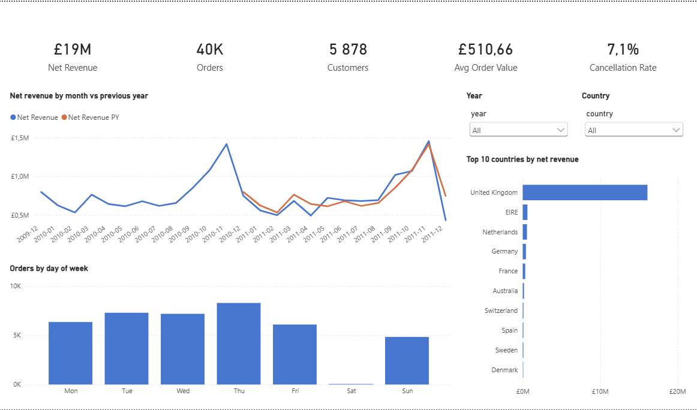
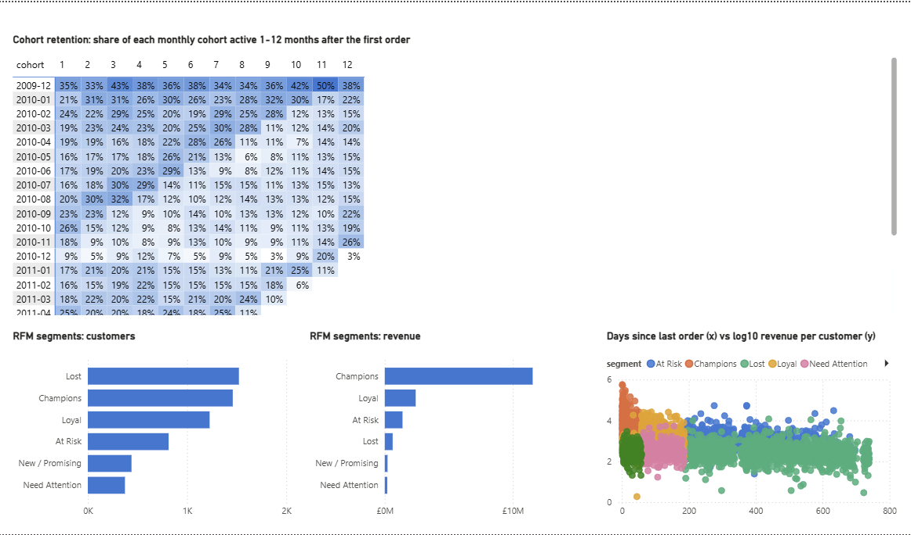
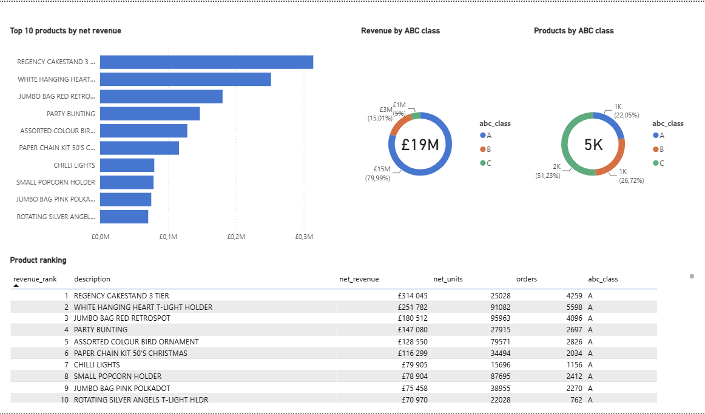
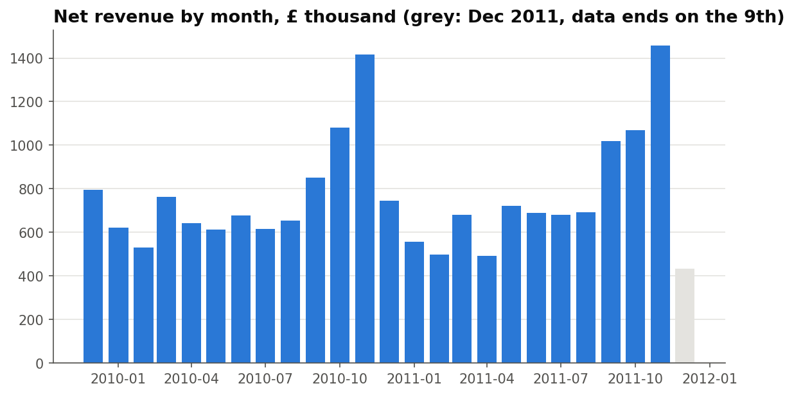
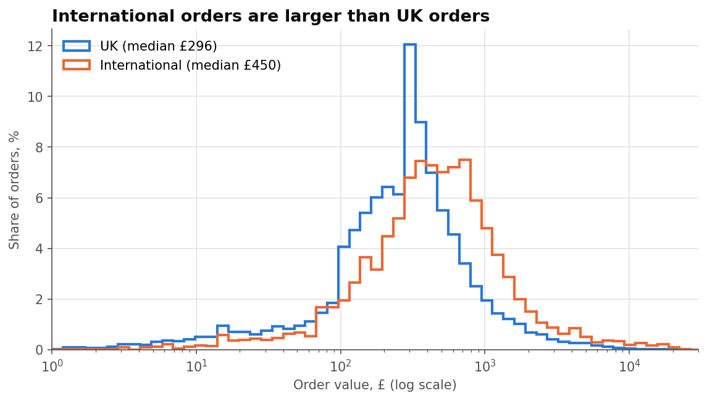
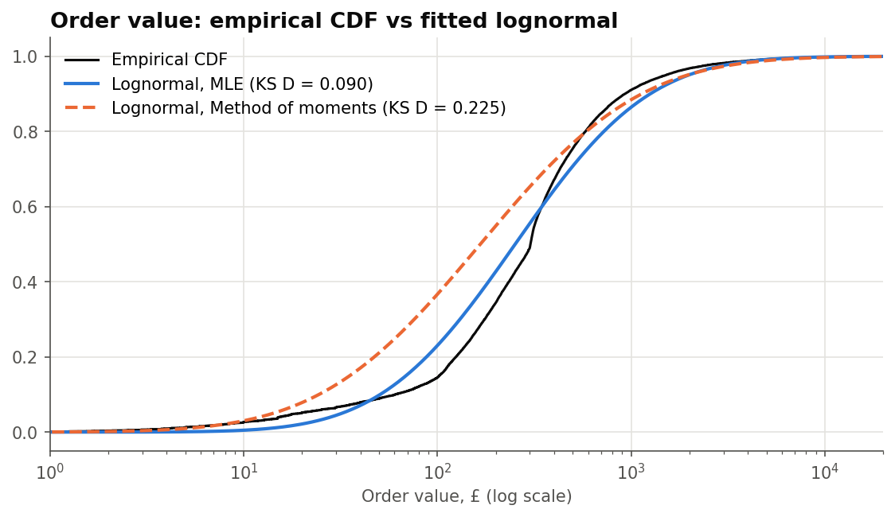
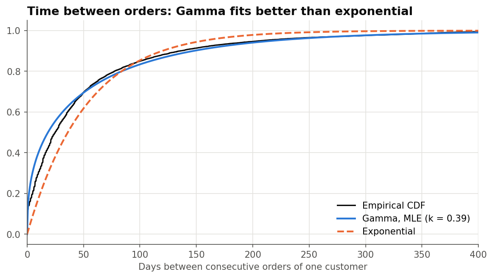
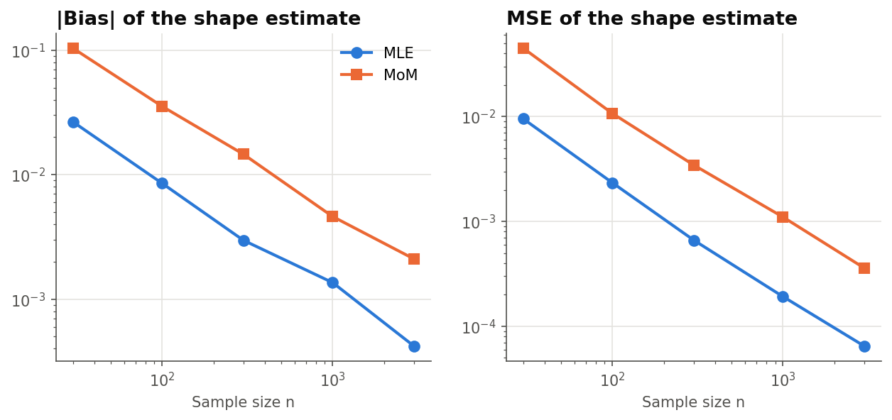

# Retail Analytics: SQL data warehouse + statistical analysis

End-to-end analysis of **1.07 million transactions** of a UK online gift retailer (UCI *Online Retail II*, Dec 2009 – Dec 2011):

* **ETL & data modeling** — Python + PostgreSQL: profiling, cleaning, star schema (fact + 3 dimensions).
* **SQL + Pandas analytics** — SQL (joins, `GROUP BY` aggregations) for monthly KPIs, YoY, countries and products; Pandas on top of the SQL views for cohort retention, RFM segmentation, ABC analysis and reorder intervals.
* **Statistics** — Python (Pandas, NumPy, SciPy, Matplotlib): MLE vs method of moments, confidence intervals (CLT and bootstrap), Z-tests, Kolmogorov–Smirnov, Monte Carlo study of estimators.
* **BI** — 3-page Power BI dashboard on top of the warehouse (star-schema model, 18 DAX measures), defined in code: one Python script generates the whole Power BI Project (PBIP).

## Key findings

| | Finding |
|---|---|
| Growth | Revenue was **flat year over year** (£9.27M → £9.30M, +0.4%): orders fell 4.9%, average order value rose 6.8%. |
| Seasonality | Sep–Nov is the peak: November revenue is **~2× a summer month**. |
| Customers | **24% of customers make 80% of revenue**. The RFM *Champions* segment is 25% of customers and 70% of revenue; 26% of customers are *Lost*. |
| Retention | Only **16–26% of customers in the Jan–Nov 2010 cohorts** buy again in the month after their first order, but 72% of customers (95% CI [71.2%; 73.5%]) eventually make a 2nd order. |
| Products | **22% of products make 80% of product revenue** (ABC class A). |
| International | A typical international order is **1.77× a UK order** (95% CI [1.69; 1.84], Z-test on log values, p < 10⁻¹⁵⁰), but international customers are **not more loyal**: repeat rate 71.8% vs 72.4%, two-proportion Z-test p = 0.77. |
| Typical order | Median order value **£302** (bootstrap 95% CI [£301; £303]); the mean (£511, CI [£496; £525]) is pulled up by a few wholesale orders. |
| Reorder timing | Time between orders is Gamma with shape **k = 0.39 < 1** (MLE): the chance of reordering falls the longer a customer is silent, so lapsing customers should be contacted early. The exponential model is rejected (likelihood-ratio test). |
| Methodology | In a Monte Carlo study (1,000 replicates, n = 30…3,000) MLE has **~5× lower MSE** than the method of moments for the Gamma shape; both are consistent. |

## Power BI dashboard

**Overview** — KPIs, monthly revenue vs previous year, top countries, orders by weekday; year and country slicers.



**Customers** — cohort retention heatmap, RFM segments, recency vs revenue per customer.



**Products** — top products, ABC classes, product ranking.



## Statistical charts

| | |
|---|---|
|  |  |
|  |  |



## Pipeline

```
online_retail_II.xlsx (2 sheets)
  └─ scripts/01_extract.py      → online_retail_ii.csv (1,067,371 rows)
  └─ scripts/02_profile.py      → data-quality report (missing values, duplicates, cancellations, odd codes)
  └─ scripts/03_build_db.py     → PostgreSQL database `retail`
        sql/01_schema.sql         schemas staging / dw / bi, star schema
        scripts/warehouse.py      dim_date (Pandas date range)
        sql/02_transform.sql      cleaning + load: dim_product, dim_customer, fact_sales (1,027,016 rows)
        sql/03_views.sql          aggregated views: monthly KPIs, countries, customer and product totals
        scripts/warehouse.py      Pandas on top of the views → bi.cohort_retention, bi.customer_rfm, bi.product_abc
  └─ scripts/04_run_analysis.py → sql/04_analysis.sql + Pandas → results/analysis_results.md
  └─ statistical_analysis.ipynb → statistical models, tests, figures
  └─ powerbi/build_pbip.py      → powerbi/RetailAnalytics.pbip (TMDL model + PBIR report, 3 pages)
```

**Cleaning rules** (same in SQL and in the notebook): drop non-numeric invoices (accounting adjustments), zero/negative prices, zero quantities and exact duplicates; keep cancellations (`C…` invoices) as negative revenue; flag service codes (postage, Amazon fees, bank charges, manual adjustments) so they don't distort product rankings.

**Data model** (`dw` schema):

```
dim_date ─┐
dim_product ─┼── fact_sales (invoice, invoice_ts, quantity, unit_price, revenue, is_cancellation)
dim_customer ─┘      revenue is a generated column: quantity × unit_price
```

## Results

* [`results/analysis_results.md`](results/analysis_results.md) — 8 SQL queries (funnel, service codes, monthly KPIs, YoY, top products, countries, weekday/hour) and 7 Pandas analyses (MoM growth, ABC, repeat rate, reorder gaps, cohorts, RFM, customer concentration).
* [`statistical_analysis.ipynb`](statistical_analysis.ipynb) — statistical part, with outputs.

## How to run

Requirements: Python 3.10+, PostgreSQL 14+.

```bash
pip install -r requirements.txt

# 1. Data: download "Online Retail II" from https://archive.ics.uci.edu/dataset/502/online+retail+ii
#    and put online_retail_II.xlsx into data/raw/
python scripts/01_extract.py data/raw/online_retail_II.xlsx data/raw/online_retail_ii.csv
python scripts/02_profile.py data/raw/online_retail_ii.csv

# 2. Warehouse (uses standard libpq variables PGUSER / PGPASSWORD / PGHOST)
python scripts/03_build_db.py data/raw/online_retail_ii.csv
python scripts/04_run_analysis.py

# 3. Statistics
jupyter notebook statistical_analysis.ipynb
```

```bash
# 4. Power BI (Desktop with PBIP support)
python powerbi/build_pbip.py          # generates powerbi/RetailAnalytics.pbip
# open powerbi/RetailAnalytics.pbip → Refresh → PostgreSQL credentials (Database tab)
```

The repository keeps only the generator, [`powerbi/build_pbip.py`](powerbi/build_pbip.py): it writes the semantic model as TMDL (tables, relationships, Power Query, DAX measures) and the report as PBIR JSON (pages and visuals). The generated `RetailAnalytics.*` files are build output and are git-ignored. To change the dashboard, edit `TABLES`, `MEASURES` or the page functions in the script, close Power BI Desktop and rerun it.

## Tech stack

PostgreSQL · SQL (joins, `GROUP BY` / `HAVING`, aggregate functions, views) · Python · Pandas · NumPy · SciPy (`stats`, `optimize`, `special`) · Matplotlib · Jupyter · Power BI (PBIP, TMDL, DAX, Power Query M)
